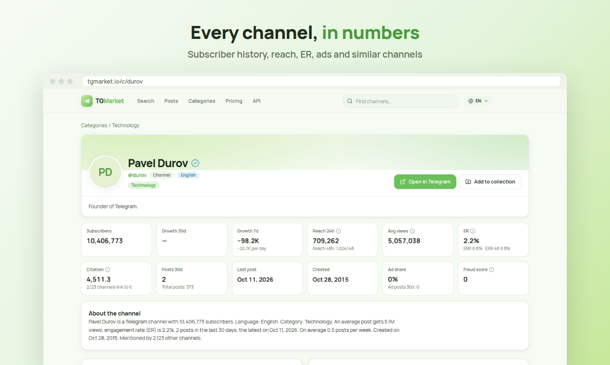

<p align="center"></p>

# TG Market MCP Server

Remote [Model Context Protocol](https://modelcontextprotocol.io) server for [TG Market](https://tgmarket.io), a searchable database of public Telegram channels. Connect it to Claude, ChatGPT, Cursor, VS Code or any MCP client to research channels, audiences and trends without leaving the conversation.

- **Endpoint:** `https://tgmarket.io/mcp` (Streamable HTTP)
- **Auth:** OAuth 2.0 with Dynamic Client Registration, or an API key as a Bearer token
- **Official MCP Registry:** `io.tgmarket/tgmarket`
- **Docs:** https://tgmarket.io/docs/mcp
- All tools are read-only.

This repository holds the registry manifest and connection instructions. The server itself is a hosted service; there is nothing to install.

## What you can do

- Find channels by topic, language, country, audience size, growth and engagement.
- Open a channel card: subscribers, 24h reach, ER/ERR, growth, citation index, fraud score and share of ad posts.
- Get daily history of subscribers, views, ER and reach.
- Read recent posts of a channel and run full-text search across Telegram posts.
- Track how often a keyword is mentioned over time.
- Check the price of a full data export before ordering it on the website.

Example prompts:

- "Find English crypto channels with more than 100k subscribers."
- "Show the subscriber history of @durov for the last 30 days."
- "How often was 'airdrop' mentioned in Telegram posts last month?"

## Tools

| Tool | Description |
|---|---|
| `search_channels` | Search channels by text and filters |
| `count_channels` | Count matching channels with total audience, average reach/ER and facets |
| `get_channel` | One channel's card |
| `get_channel_history` | Daily series: subscribers, views, ER, 24h reach, ERR |
| `get_channel_posts` | Recent posts with text, date and views |
| `search_posts` | Full-text search across posts |
| `keyword_trend` | Keyword mentions per day or week |
| `quote_export` | Price of a full export before ordering |
| `list_categories` | Category tree for filters |
| `list_languages` | Language codes with channel counts |
| `list_geo` | Countries and regions with channel counts |
| `get_usage` | Credit balance, plan and daily usage |

## Connect

### Claude (claude.ai, Desktop) and ChatGPT

Add a custom connector with the URL `https://tgmarket.io/mcp`, then sign in to TG Market and click **Allow**. No API key needed.

- Claude: Settings → Connectors → Add custom connector.
- ChatGPT (developer mode): Settings → Apps & Connectors → Create, authentication OAuth.

### Claude Code

```bash
claude mcp add --transport http tgmarket https://tgmarket.io/mcp \
  --header "Authorization: Bearer mk_live_..."
```

### Cursor (`~/.cursor/mcp.json`)

```json
{
  "mcpServers": {
    "tgmarket": {
      "url": "https://tgmarket.io/mcp",
      "headers": { "Authorization": "Bearer mk_live_..." }
    }
  }
}
```

### VS Code (`.vscode/mcp.json`)

```json
{
  "servers": {
    "tgmarket": {
      "type": "http",
      "url": "https://tgmarket.io/mcp",
      "headers": { "Authorization": "Bearer mk_live_..." }
    }
  }
}
```

### Clients without HTTP support (via mcp-remote)

```json
{
  "mcpServers": {
    "tgmarket": {
      "command": "npx",
      "args": ["-y", "mcp-remote", "https://tgmarket.io/mcp", "--header", "Authorization:${MK_AUTH}"],
      "env": { "MK_AUTH": "Bearer mk_live_..." }
    }
  }
}
```

Get an API key in your account at [tgmarket.io](https://tgmarket.io) (free sign-up).

## Pricing

Free accounts get a daily trial; paid plans spend credits. Lookup tools (`list_*`, `get_usage`) are free. See [tgmarket.io/docs/mcp](https://tgmarket.io/docs/mcp) for per-tool costs.

## Links

- Website: https://tgmarket.io
- REST API docs: https://tgmarket.io/docs/api
- Support: support@tgmarket.io


